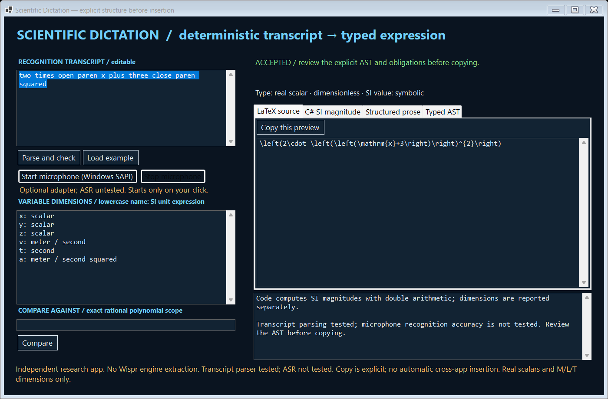
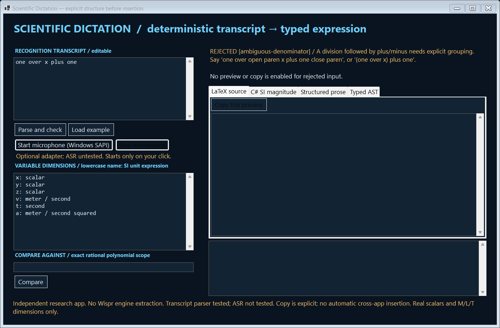

# Scientific Dictation

Paste a maths sentence and inspect how it is grouped before copying the result into a document or code. Unclear wording is flagged for clarification instead of being quietly turned into a plausible-looking formula.

'One over x plus one' could mean 1/(x + 1) or (1/x) + 1. A neat-looking formula can still express the wrong calculation. You need to see the interpretation, not just a polished rewrite of your words.

**Example:** Say explicitly whether 'x plus one' is the whole denominator, or whether the final '+ 1' is outside the fraction. The app shows the grouping and generates document maths, C# code and a readable explanation from that same interpretation. You can also declare simple variable units to catch incompatible combinations.

**What you install:** A separate Windows app for checking maths written in spoken-style words.

**Current scope:** This supports a small defined maths vocabulary, not arbitrary spoken mathematics. It is independent of Wispr's engine. Text parsing and code examples were tested; the optional microphone and speech-recognition path remain untested.

[Live guide](https://az9713.github.io/rea-wispr-scientific/) · [Download packages](https://github.com/az9713/rea-wispr-scientific/releases/tag/v0.1.1)




## A usable Windows app

Download `Scientific-Dictation-v0.1.1-win-x64.zip`, extract it, and run **scientific.exe**. Keep the extracted files together; the .NET runtime is included. No Wispr installation, account, API key or global .NET installation is required. Compatibility was tested on the build machine, not a Windows version matrix.

1. Paste or edit a recognition transcript. Any dictation source can supply text; this app does not read another app's history or intercept its audio.
2. Declare variable dimensions, one line each: `x: scalar`, `v: meter / second`, `t: second`. Variables have no numeric assignments and represent SI magnitudes in generated code.
3. Click **Parse and check**. Inspect LaTeX source, C# code, structured prose, typed AST and domain obligations. Editing the transcript/declarations invalidates previews and disables copying.
4. Use an explicit **Copy this preview** button and paste manually. Rejected input has no copyable generated preview. Clipboard behavior is implemented; tests check copy gating without changing the user's clipboard.
5. Optionally compare a second transcript using the same declarations. Results are **equivalent**, **different** or **unknown**, with a reason. This is not a general computer algebra system.

### Examples

| Transcript | Result |
|---|---|
| `two times open paren x plus three close paren squared` | `2 * (x + 3)^2` |
| `one over x plus one` | Rejected: group the denominator or the quotient |
| `one over open paren x plus one close paren` | `1 / (x + 1)` |
| `minus two squared` | `-(2^2) = -4`; the precedence note is visible |
| `open paren minus two close paren squared` | `(-2)^2 = 4` |
| `two meters plus three seconds` | Rejected: incompatible dimensions |
| `v times t` | Length, for the default velocity/time declarations |



## Optional microphone adapter

**The transcript parser is tested. Automatic speech recognition is not tested.** No microphone was accessed during development or release verification.

The Windows Forms app includes a Microsoft `System.Speech` 9.0.22 adapter. Only pressing **Start microphone** constructs the recognizer and calls the default-audio-device API. It requests one English-US dictation utterance. **Stop microphone** cancels it. An installed compatible Windows SAPI recognition engine and microphone permissions are required; either may be unavailable. Failure leaves transcript input usable. Engine confidence is an uncalibrated recognizer score, not mathematical correctness.

Recognized text is placed in the editable transcript field. It is not automatically parsed, copied or inserted elsewhere. Review/correct it and press Parse. This app saves no audio file and makes no recognition cloud API call; underlying Windows speech components and device behavior are outside the parser's guarantees. The adapter is compiled, not acoustically validated. Wispr's recognition engine was not extracted or reused.

## Command line

The same release contains **scientific-cli.exe**:

```powershell
.\scientific-cli.exe --parse "one over open paren x plus one close paren"
.\scientific-cli.exe --parse "v times t" --variables .\variables.txt
.\scientific-cli.exe --compare "open paren x plus one close paren squared" "x squared plus two times x plus one"
.\scientific-cli.exe --fixtures .\parser-cases.json
.\scientific-cli.exe --self-test .\new-test-output
```

`--parse` emits the full typed result as JSON; exit 0 accepted, 2 rejected, 1 runtime/argument error, 64 usage. `--compare` returns a three-way verdict in JSON with exit 0, including `unknown`; inspect the verdict rather than treating the process exit as an equality proof. `--fixtures` checks a JSON array of expected acceptance/error outcomes. `--self-test` writes a structured report. No microphone or clipboard access is performed by the CLI.

The GUI has a synthetic diagnostic mode:

```powershell
.\scientific.exe --self-test C:\YOUR_WORKSPACE\new-ui-test
```

It runs the parser suite, renders accepted/rejected native UI states, and checks stale/copy gating and multiline declarations. Use a new output directory. It does not construct the recognizer or change the clipboard. A short app window is rendered during the test.

## Mathematical contract

- Real scalar expressions only. Operators: `+ - * / ^`, unary minus, squared/cubed, explicit parentheses. Powers associate right; unary minus binds less tightly than powers. Postfix squared/cubed binds to its immediate atom. Thus `two meters squared` means `2 * meter^2`; group a full quantity if you intend to square its magnitude too.
- Numbers: digits and numeric decimals, or single English words zero through twenty. Compound numbers, spoken decimal points, homophone corrections and unknown symbols are rejected. Multiplication must be explicit except a following recognized unit.
- Functions: sin, cos, sqrt, exp, natural log; arguments require parentheses. Trig angles are dimensionless radians. Known constant domain errors, division by constant zero and non-finite numeric results are rejected. Symbolic domain restrictions remain visible obligations; they are not solved.
- Dimensions: integer mass/length/time exponents only. Units: meter, centimeter, second, kilogram, newton and their plurals. Centimeters normalize exactly to SI scale. Variable declarations use SI unit expressions of magnitude one. No temperatures, affine units, electrical quantities, vectors, tensors, uncertainty propagation, calculus, equations or assignment syntax.
- Addition requires matching dimensions; even zero is not silently given another term's units. Dimensioned powers require a known integer exponent from -12 to12. Square roots require even dimension exponents.
- Numeric previews/C# use finite IEEE double arithmetic; decimal equivalence uses exact rational arithmetic. C# numeric literals are explicitly floating-point, preventing integer-division changes. C# output represents SI magnitudes; dimensions are reported separately, not carried by C# types. Variable declarations/values must be supplied by the consuming program.
- Exact equivalence supports rational polynomials, division by nonzero constants and positive integer powers1–8, with expansion/degree/coefficient budgets. No sampling is accepted as proof. Functions, pi/e, symbolic denominators and exponent-zero domain cancellation return unknown. A different polynomial means different formal expressions over independent declared symbols, not different values at every numerical assignment.

See [the complete grammar and budgets](docs/grammar.md).

## Why build this when Wispr has Transforms?

Wispr's official desktop documentation already describes beta Transforms, custom prompts, diffs, undo and automatic post-dictation application. Its dictionary also supports technical vocabulary. A generic “rewrite my speech as math” prompt overlaps that baseline.

This project instead defines a small deterministic language with visible parse structure, dimension checks, conservative rejection and bounded exact equivalence. It is an original independent workbench, not a modification of Wispr, a plugin, a claim that Wispr has no math formatting, or an extracted proprietary model. [Investigation and primary sources](investigation/findings.md) distinguish those routes explicitly.

## Build and verification

Prerequisites: Windows x64, PowerShell, Python3, and public Microsoft/NuGet download access. Build scripts acquire a local .NET SDK9.0.320 ZIP and verify its SHA512 against official release metadata. Cache/temp/CLI home stay inside the checkout, and automatic development-certificate generation is disabled before SDK use. To reuse an already downloaded portable SDK, set `SCIENTIFIC_DOTNET` to its absolute dotnet.exe path.

```powershell
.\scripts\build.ps1 -Publish
.\scripts\test.ps1
.\scripts\package.ps1
```

The **52-case suite** covers precedence, unary/power behavior, ambiguity, invalid tokens, domain/zero-division errors, dimensions, SI scaling, exact identities/non-identities, unknown equivalence, generated-code semantics and resource budgets. Native UI diagnostics exercise accepted/rejected states and stale-copy gating. Fixture explorer data is generated by the actual released CLI, not an independent browser parser. Published and extracted ZIP executables receive additional smoke tests. Optional browser checks use Playwright1.64.1 (`scripts/verify_docs.cjs`). No ASR, real microphone, cross-app insertion or acoustic performance claim follows from these tests.

Packaging uses an exact public-file manifest and project-bound path checks. The source ZIP excludes caches, generated binaries, private investigation baseline and local handoff. Builds are source-reproducible by these steps; bit-for-bit compiler/dependency reproducibility is not claimed.

## License

Original code: [MIT](LICENSE). Microsoft runtime/System.Speech licenses and notices are retained; see [NOTICE.md](NOTICE.md). Independent software, no affiliation with Wispr or Microsoft. Provided without warranty; review outputs before using them in research or production.

## Release 0.1.1: compiler path privacy

This rebuild maps local source paths to virtual `/_/` paths before compilation and checks every packaged PE file for literal project/profile path markers in ASCII/UTF8 and UTF16LE. Debug-symbol files are excluded too. The 0.1.0 binary packages are superseded because compiler metadata retained local build paths. The source and feature behavior are otherwise unchanged. This bounded scan does not establish the absence of every possible embedded or compressed private value.
